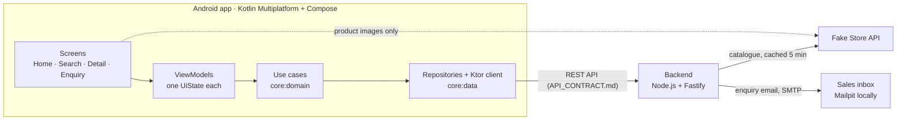

# Officeworks catalogue PoC

An Android app for browsing, searching and enquiring about products, with a small backend in front of
the [Fake Store API](https://fakestoreapi.com). Enquiries are emailed to a sales inbox.

**Stack, and why**

- **Client: Android app in Kotlin**, structured as Kotlin Multiplatform with Compose Multiplatform UI
  (Android target only). Kotlin and Compose are my strongest stack, and keeping domain, data and UI in
  shared modules enforces the boundaries the brief asks for, while leaving room for iOS later.
- **Backend: Node.js + TypeScript** (Fastify, zod). The brief prefers TypeScript; Fastify and zod give
  typed validation and fast in-process tests with little code. It sits between the app and Fake Store,
  so the data source and email provider can change without touching the app.

More in [DECISIONS.md](DECISIONS.md).

## Run it

You need **[Android Studio](https://developer.android.com/studio)**, plus either **Docker** or
**[Node.js](https://nodejs.org) 22.9+** for the backend. Run the commands from the project folder
unless a step says otherwise.

**1. Start the backend** (pick one, and leave it running)

<details open>
<summary><b>Option A: Docker</b> (one command, any OS)</summary>

```bash
docker compose up --build
```

Older Docker versions use `docker-compose up --build` instead.

</details>

<details open>
<summary><b>Option B: Node.js, no Docker</b> (two terminals)</summary>

Terminal 1, the mail catcher ([Mailpit](https://mailpit.axllent.org)), so enquiry emails have somewhere to go.
This one can run from any folder, e.g. Downloads:

| OS | Install once | Run |
|---|---|---|
| macOS | `brew install mailpit` | `mailpit` |
| Linux | `sudo sh < <(curl -sL https://raw.githubusercontent.com/axllent/mailpit/develop/install.sh)` | `mailpit` |
| Windows (PowerShell) | `Invoke-WebRequest https://github.com/axllent/mailpit/releases/latest/download/mailpit-windows-amd64.zip -OutFile mailpit.zip`<br>`Expand-Archive mailpit.zip mailpit` | `.\mailpit\mailpit.exe` |

Terminal 2, the API. Same commands on every OS:

```bash
cd backend
npm install
npm run dev
```

Every backend setting has a working default, so there's nothing to configure (`backend/.env.example`
lists them). Without Mailpit the app still browses and searches; only sending an enquiry fails.

</details>

Either way, the backend is ready when http://localhost:3000/api/v1/products/featured shows 5 products,
and enquiry emails appear at http://localhost:8025.

**2. Open the project in Android Studio and start an emulator**

Opening it once lets Android Studio find your Android SDK. Then **Device Manager** → ▶ on any phone.

**3. Install the app** (in a new terminal)

| macOS / Linux | Windows |
|---|---|
| `./gradlew :androidApp:installDebug` | `gradlew.bat :androidApp:installDebug` |

Or in Android Studio, pick **androidApp** and press ▶ Run. If the command line says Java is missing,
use the Run button, or point `JAVA_HOME` at the JDK bundled with Android Studio.

**4. Try it**

| Check | How |
|---|---|
| 5 featured products | Open the app |
| Category: 3 top rated, then the rest | Tap a category chip; tap it again to go back |
| Search | Type "jacket" and press search; "zzzz" shows the empty state |
| Product page | Tap any product |
| Enquiry | Product → **Enquire** → fill in name and email → **Send** → "Thank you". The email arrives at http://localhost:8025 |

<details>
<summary>Real phone or another machine?</summary>

The emulator reaches your computer at `10.0.2.2`. For anything else, pass the backend's address:

```bash
./gradlew :androidApp:installDebug -Pofficeworks.baseUrl=http://192.168.1.20:3000/api/v1/
```

</details>

## How it fits together



All product data comes from the backend; only product images load straight from the image URLs Fake
Store provides (see DECISIONS.md, "Images"). Each enquiry carries an idempotency key, so a retry can't
email sales twice.

## Run the checks

One command runs everything in order, like CI: format and lint → unit tests → UI tests → release build →
install. It needs an emulator running, not the backend.

```bash
./scripts/ci.sh          # add --fix to auto-format first
```

On Windows, run it from Git Bash or WSL. Backend checks: `cd backend && npm run check` (also run by
GitHub Actions on every PR that touches `backend/`).

| Step | What it checks |
|---|---|
| 1 | ktlint and Compose rules on every Kotlin file |
| 2 | Unit tests in every module (JVM) |
| 3 | Compose UI tests and whole-app navigation tests on the emulator |
| 4 | Release build with R8 (built, not installed) |
| 5 | Installs the debug app |

After a backend change, refresh the app's contract test data (backend running):
`./scripts/capture-contract-fixtures.sh`.

## Project layout

```
backend/            Node.js + TypeScript API (backend/README.md)
androidApp/         Android entry point
shared/             App shell: navigation and dependency wiring
core/domain/        Models, repository interfaces, use cases (pure Kotlin)
core/data/          API client, DTOs, repositories
core/ui/            Theme (light/dark) and shared components
feature/catalogue/  Home, category filter, search, product page
feature/enquiry/    Enquiry form and thank-you screen
```

## More

- [DECISIONS.md](DECISIONS.md): why it's built this way, assumptions, what was cut, known limitations
- [API_CONTRACT.md](API_CONTRACT.md): the API both sides are built against
- [AI_USAGE.md](AI_USAGE.md): how AI was used, and where it got things wrong
- [CLAUDE.md](CLAUDE.md): rules for AI agents working in this repo
